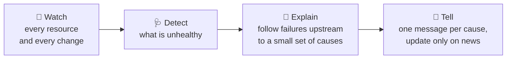

<p align="center">
  <a href="https://kwatch.dev">
    <picture>
      <source media="(prefers-color-scheme: dark)" srcset="./assets/logo-dark.svg">
      
    </picture>
  </a>
</p>

<h2 align="center">See what broke. Understand why. Know what to do next.</h2>

<p align="center">
  kwatch is the on-call teammate for your Kubernetes cluster. When something
  breaks, it finds <b>the one thing that caused it</b> and tells your team in
  plain words, with the command to fix it.
</p>

<p align="center">
  <a href="#-quick-start"><b>Quick start</b></a> ·
  <a href="#-editions">Editions</a> ·
  <a href="https://kwatch.dev">Website</a> ·
  <a href="https://docs.kwatch.dev">Docs</a> ·
    <a href="https://discord.gg/kzJszdKmJ7">Discord</a>
</p>

<p align="center">
  <a href="https://github.com/abahmed/kwatch/releases"></a>
  <a href="https://github.com/abahmed/kwatch/stargazers"></a>
  <a href="https://github.com/abahmed/kwatch/actions/workflows/ci.yml"></a>
  <a href="./LICENSE"></a>
</p>

## 🎯 Why kwatch

- **Root cause first.** kwatch follows a failure back through everything it
  depends on and names the one cause: a bad release, a full node, an expired
  certificate, a database outside the cluster. Twenty symptoms become one
  incident.
- **Quiet by default.** Successful rollouts, scaling, node drains and the odd
  restart never wake anyone. Updates go out only when something new is true,
  and a storm of 1,000 failing pods from one cause is at most 3 messages.
- **Who changed what.** Rollouts, config edits and image updates sit on a
  timeline with who made them, so a message can say *"after alice's 14:02
  release"*.
- **The next step.** Each message ends with the command to run: read the
  crash log, describe the node, or roll back.
- **Yours, in your cluster.** One small Pod, read-only access, no SaaS.
  Cluster data leaves only as the alerts you configure.

## 😩 2:14 AM. Your phone lights up twenty times.

A release went out. Now pods are crash looping, a Service has no endpoints,
the Ingress returns 503s, and two other apps are failing their health checks.
Every alert is true. **None of them tells you why.** So you open a terminal
and start digging.

## 😌 With kwatch, you get one message

<table>
<tr>
<th width="50%">Typical alerts without kwatch</th>
<th width="50%">With kwatch</th>
</tr>
<tr>
<td valign="top">

```text
🔥 Pod api-7d9f-x2k CrashLoopBackOff
🔥 Pod api-7d9f-q8n CrashLoopBackOff
🔥 Pod api-7d9f-m4c CrashLoopBackOff
⚠️ Service api has no endpoints
⚠️ Ingress storefront 503
🔥 Pod checkout-5b2c-p1z Readiness failed
🔥 Pod checkout-5b2c-k7w Readiness failed
... 13 more
```

</td>
<td valign="top">

```text
🔴 api is down in shop (prod-eu-1)
after the 14:02 release of api:2.3. alice
released it; the previous image was
api:2.2. Only pods of the new
revision fail. Service api and
ingress storefront can't serve traffic.
checkout is affected as well. Rolling
back fixes it (changes the cluster):
kubectl rollout undo deployment/api
-n shop --to-revision=13
```

</td>
</tr>
</table>

**What broke, why, who changed it, what else is hit, and how to fix it**, in
one message, before you have even opened your laptop. When it is fixed, you
hear about it once:

```text
✅ api in shop (prod-eu-1) is healthy again. It was down for eight
minutes.
```

## ⚙️ How it works



1. **Watch.** kwatch keeps a live map of your cluster: every object, how they
   connect, and a timeline of what changed and who changed it.
2. **Detect.** It spots what is unhealthy: crash loops, unready nodes,
   Services with no endpoints, full volumes, failing webhooks and more.
3. **Explain.** From each failure it walks to what it depends on and keeps
   only suspects that are broken or changed just before. Then it picks the
   causes that explain everything, preferring stronger evidence over
   covering more failures.
4. **Tell.** One message per cause, written for people. It is updated only
   when something new is true, and closed once when it is fixed.

## 🚀 Quick start

**Installer.** It asks which cluster and which channel (Slack, Teams,
PagerDuty, ...), stores the credentials in a Kubernetes Secret, installs
kwatch and checks that it is running. Run it again any time to upgrade,
change settings, manage the license or uninstall.

```bash
/bin/bash -c "$(curl -fsSL https://kwatch.dev/kwatch.sh)"
```

For advanced users who prefer Helm, see the [chart guide](./deploy/chart/README.md).

## 🧩 Editions

One binary, two editions. Community needs no account and no key. Pro needs a
license key, one per cluster.

| | Community | Pro |
| --- | --- | --- |
| Detection | Pod crash loops, OOM and Pending; node NotReady | Adds node pressure and draining, readiness, rollouts, Jobs and CronJobs, PDBs, HPAs, storage, network, admission, certificates, quota, custom resources, control plane, probes and unusual events |
| Analysis | Root-cause headline | Full proof, shared-factor suspects, who changed what, impact, log excerpts |
| Incidents | Basic dedup and noise control, state in memory | Flapping detection, startup summary, state kept on disk across restarts, changes made while kwatch was down |
| Delivery | 1 provider (pick with `app.communityProvider`), namespace filters and silences | All providers, routing by scope, threads, text templates, audit log |
| Ops | RBAC audit, secret redaction, health, metrics, text `/status` | Severity overrides, maintenance holds, runbook links, heartbeat monitor, `/status` JSON, flight recorder and `replay-export`, standby replicas |

When a Pro license ends, kwatch falls back to Community.
Detection and alerting never stop. The authoritative feature list is the
catalog in [`internal/feature`](./internal/feature); compare editions on
[kwatch.dev/pro](https://kwatch.dev/pro) and get Pro free at
[kwatch.dev/signup](https://kwatch.dev/signup).

## 🔑 Activating Pro

[Sign up](https://kwatch.dev/signup), get a free Pro license on your account page
and copy your key. Then give it to kwatch.

Run the installer, open its **License / Pro** menu and choose **Add or replace
key**:

```bash
/bin/bash -c "$(curl -fsSL https://kwatch.dev/kwatch.sh)"
```

For a non-interactive install, set `KWATCH_LICENSE_KEY=KW1-...` in the
environment of the same command.

**How it works**

- One key covers one cluster. The first successful check binds it.
- kwatch renews daily. Each lease lasts 3 days, followed by a 4-day grace
  period, so a cluster can be offline for up to 7 days.
- You get 3 transfers per 30 days to move a key to another cluster.
- When a license expires, kwatch falls back to Community and alerting never
  stops.
- The license state is in `/status` and in the installer's **License / Pro**
  menu (**Show license status**).

**What is sent.** The hashed cluster ID, the kwatch version, the node count
and the instance public key. Community without a key makes no license calls.
Details: [licensing in the configuration guide](./docs/configuration.md) and
the [license guide](https://kwatch.dev/docs/license).

## 🔁 More messages

One node runs low on memory and starts evicting pods. Instead of one alert
per pod, you get one message with the cause, then one when it is over.

Messages are written as short lines, with the resource names in bold, text
from your pods in code and the command in a code block. Slack, Discord,
Telegram, Jira and the other chat and ticket providers show it as below;
SMS, push and pager providers get the same lines as plain text.

```text
🟠 **Node n1** (**prod-eu-1**) is low on memory. All of its dependents are failing.
Replicas that do not depend on it are healthy.
**cart**, **orders** and **api** in **shop** are affected as well.
To check the node's conditions and recent events, run
    kubectl describe node n1
```

```text
✅ **Node n1** (**prod-eu-1**) is ready again. It was failing for ten minutes.
```

The same goes for the other incidents you care about:

```text
🟠 **api** is failing in **shop** (**prod-eu-1**) after the 10:01 release of registry.example.com/api:2.3.
The previous image was registry.example.com/api:2.2.
It fails with `panic: missing key DB_PASSWORD_V2`.
To see the rollout state, run
    kubectl rollout status deployment/api -n shop
```

Messages that list several problems are short lists, the ones that need
attention first and what resolved on one line. kwatch reports what is
happening, not what could happen: advice such as a single replica or a missing
probe is never listed:

```text
🟡 **kwatch digest** · staging — 2 problems · 5 resolved

**Problems**
• Node **ip-10-0-67-211** — failing again
• Service **ingress-nginx** (**kube-addons**) — Kubernetes reported FailedDeployModel 3 times in the last quarter hour

✅ 5 resolved since last digest: accounts, assets, comms +2
```

```text
🟠 **kwatch** · prod-eu-1 — 2 new problems at the same time

**Problems**
• **ledger** in **billing** keeps crashing
• **checkout** in **orders** keeps crashing

_Each gets its own message when it changes or resolves._
```

One message per problem, with its cause and the command to fix or check it.
Known and low-priority problems stay quiet, and the resolve message tells you
what happened.

When five apps fail because a database outside the cluster is down, kwatch
blames the database, not the apps:

```text
🟠 api in shop (prod-eu-1) keeps crashing because external endpoint
db.example.com:5432 refuses connections. It fails with "dial tcp
db.example.com:5432: connect: connection refused". Every error mentions it.
cart, search, auth and one other are affected as well. To read the output
of the last crash, run
kubectl logs api-6d4f-0 -c app -n shop --previous
```

When a node disappears:

```text
🔴 Node n1 (prod-eu-1) has not reported for about two minutes. It reports
"Kubelet stopped posting node status". To check the node's conditions and
recent events, run kubectl describe node n1
```

When kwatch is not sure, it says so instead of guessing. One emoji tells you
how urgent it is: 🔴 page · 🟠 notify · 🟡 low · ✅ resolved.

## 📣 Alerts where your team already is

**56 destinations**, including Slack, Microsoft Teams, Discord, Google Chat,
Mattermost, Telegram, email, PagerDuty, Opsgenie, incident.io, Jira, Datadog
and plain webhooks. Paging tools get a stable key, so the same problem always
updates the same page and closes it when it is fixed.
[See all channels →](https://kwatch.dev/docs/channels)

## 🔍 What it catches

| | |
| --- | --- |
| 📦 **Apps** | Crash loops, OOM kills, bad rollouts, stuck Jobs and CronJobs, missing replicas |
| 🗓️ **Scheduling** | Pods that cannot be placed, quota limits, affinity and taint mismatches |
| 🖥️ **Nodes** | Lost or not-ready nodes, memory, disk and PID pressure |
| 🌐 **Network** | Services without endpoints, broken Ingress and Gateway routes, failing webhooks, unreachable external endpoints |
| 💾 **Storage** | Nearly full volumes, failed attachments, stuck claims |
| 🔐 **Config** | Missing or rotated Secrets and ConfigMaps, image pull failures, expired certificates |
| 🧩 **Your CRDs** | Anything that reports standard status conditions |

Some detectors are Pro; see [Editions](#-editions). [Full coverage list →](./docs/kubernetes-coverage.md)

## 📏 Tested like a product, not a script

Every change to kwatch is replayed against a library of real failure
scenarios, plus a hidden set nobody is allowed to tune for. The build
**fails** if it gets worse:

| We promise | And CI checks |
| --- | --- |
| It names the right cause | ≥ 90% of scenarios, ≥ 80% of the hidden set |
| It rarely claims a wrong cause with confidence | ≤ 5% |
| It never alerts on normal operations | 0 alerts |
| It is fast | page in ≤ 2 min, notify in ≤ 5 min |
| It stays small | 5,000 pods and 500 nodes in 512 MiB of memory |

[Latest scorecard →](./internal/scenarios/SCORECARD.md)

## ❓ FAQ

<details>
<summary><b>Does it replace Prometheus or Grafana?</b></summary>

No. kwatch answers *"what just broke and why"*. Keep Prometheus, Grafana and
Loki for metrics, trends and dashboards; kwatch needs no rules and works
next to them.
</details>

<details>
<summary><b>Does my data leave the cluster?</b></summary>

Only as the alerts you configure. Secrets and tokens are redacted from logs
and messages. kwatch also sends a weekly anonymous ping (a hashed cluster ID
and its version, nothing else) so we know how many clusters use it; turn it
off with `telemetry.enabled: false`. With a Pro key, the license check also
sends the data listed under [Activating Pro](#-activating-pro).
</details>

<details>
<summary><b>What access does it need?</b></summary>

Read-only access to cluster state. It writes only its own Lease, its
state file, and SelfSubjectAccessReviews for its permission audit (not
persisted). It never gets `pods/exec` or `nodes/proxy`. **By default its
ServiceAccount can read every Secret in the cluster** (kwatch keeps only
hashes, never values). Set `watch.secrets: false` (Helm: `--set
watch.secrets=false`) to remove all Secret access; `rbac.mode:
least-privilege` narrows the other kinds but still lists Secrets unless
`watch.secrets` is false. Helm prints this warning on install and kwatch logs
it once at startup.
</details>

<details>
<summary><b>How much does it cost to run?</b></summary>

The Community edition is free (see [Editions](#-editions)). kwatch runs as one Pod with a 512 MiB memory limit
and a 2 GiB volume for its state.
</details>

<details>
<summary><b>What happens when kwatch restarts?</b></summary>

With Pro, it picks up where it left off: open incidents are not announced
again, queued alerts are still sent, and changes made while it was down are
still used to explain failures. Community keeps state in memory: after a
restart it quietly takes a fresh baseline, so existing failures are not
re-sent and only new ones (or ones that get worse) alert. kwatch delivers
alerts at least once. See [production operations](./docs/production-operations.md).
</details>

<details>
<summary><b>Can I tune what it sends?</b></summary>

Yes: namespace filters, silences, maintenance annotations, severity
overrides, runbook links, an hourly message budget per channel, and
configuration through a `KwatchConfig` resource (kwatch restarts to apply it).
See the
[configuration guide](./docs/configuration.md).
</details>

## 🤝 Join us

The source is public. Report a bug, suggest an idea, or send a pull
request. New contributors can start with the
[plain-English architecture guide](./docs/contributor-architecture.md) and
step-by-step guides for adding a
[detector](./docs/contributing-detector.md),
a [propagation rule](./docs/contributing-propagation-rule.md) or a
[scenario](./docs/contributing-scenario.md).

[Open an issue](https://github.com/abahmed/kwatch/issues) ·
[Join Discord](https://discord.gg/kzJszdKmJ7) ·
[CONTRIBUTING.md](./CONTRIBUTING.md)

If kwatch saves you a night, ⭐ the repo so others can find it.

## 📄 License

kwatch is source available under the [Elastic License 2.0](./LICENSE)
(ELv2) since the release after `v1.0.0-rc.10`. You may use it for free in
your own clusters, read and change the code, and share it. You may not offer
kwatch as a hosted service or remove its license-key checks. Releases up to
and including `v1.0.0-rc.10` stay under the MIT License. See
[licensing](./docs/licensing.md).
